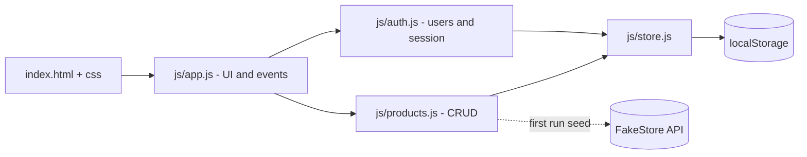

# ShopSphere - E-Commerce Storefront (Capstone)

A full front-end e-commerce app in plain HTML, CSS and JavaScript (ES modules).
**Live demo:** `https://YOUR-APP.vercel.app`  <!-- replace after deploy -->

## Features
- Authentication simulation (register / login / logout, saved in localStorage)
- Interactive catalog: live search, category tabs, sorting
- Cart with quantity change and checkout (demo)
- Admin CRUD: add, edit, delete products (login as admin)
- Persistent state (users, session, products, cart)
- Responsive, dark-ready design tokens

**Demo admin:** `admin@shopsphere.dev` / `admin123`

## Architecture


## Run locally
```bash
npx serve .
```

## Deploy (Vercel)
1. Push repo to GitHub
2. vercel.com -> New Project -> import repo
3. Framework: **Other**, no build command -> Deploy

> Note: Authentication is a simulation for learning. Real apps need a backend.
